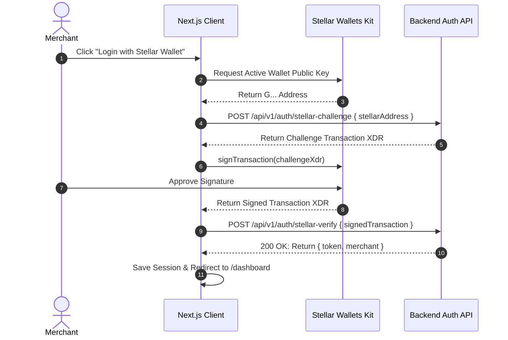
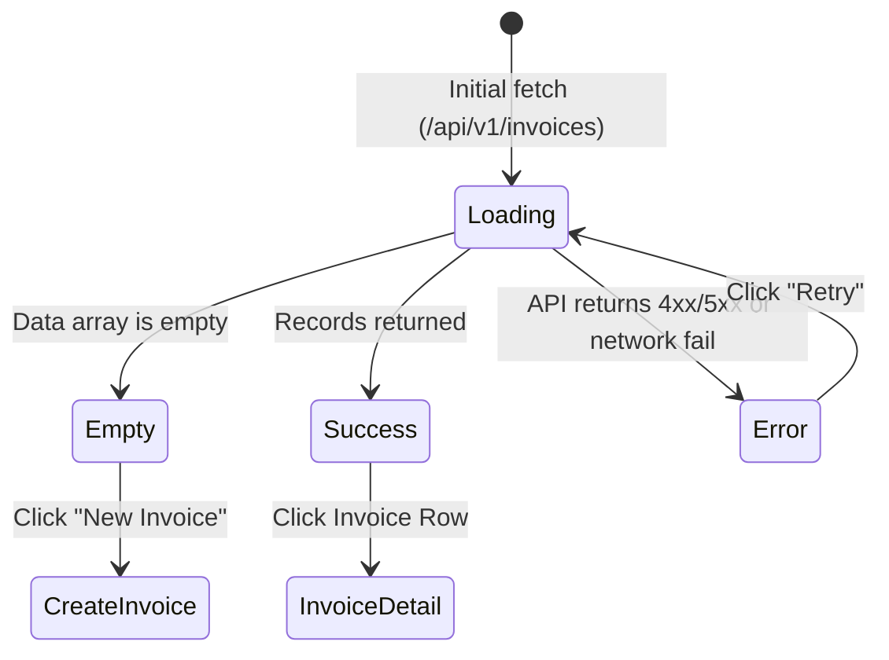

# Frontend Integration Specification & Contract Interface

**Repository:** `bill-generator-frontend`  
**Framework:** Next.js 15 (App Router) + TypeScript + Tailwind CSS  
**Cross-References:**  
- Backend API Specification: [`bill-generator-backend/openapi.yaml`](../../bill-generator-backend/openapi.yaml)
- Backend Integration Guide: [`bill-generator-backend/docs/INTEGRATION_SPEC.md`](../../bill-generator-backend/docs/INTEGRATION_SPEC.md)
- Smart Contract Specification: [`bill-generator-contracts/docs/CONTRACT_SPEC.md`](../../bill-generator-contracts/docs/CONTRACT_SPEC.md)
- Root Project Plan: [`PROJECT_PLAN.md`](../../PROJECT_PLAN.md)

---

## 1. Environment & API Base Configuration

The frontend interacts with the backend REST API, Stellar Horizon, and Soroban RPC exclusively through runtime-configurable environment variables defined in `.env.local`:

```ini
# Application Domain
NEXT_PUBLIC_APP_URL="http://localhost:3000"

# Backend REST API
NEXT_PUBLIC_API_URL="http://localhost:4000/api/v1"

# Stellar Ecosystem Nodes
NEXT_PUBLIC_STELLAR_NETWORK="TESTNET"
NEXT_PUBLIC_STELLAR_NETWORK_PASSPHRASE="Test SDF Network ; September 2015"
NEXT_PUBLIC_HORIZON_URL="https://horizon-testnet.stellar.org"
NEXT_PUBLIC_SOROBAN_RPC_URL="https://soroban-testnet.stellar.org"

# Deployed Smart Contract ID (Set once Phase 1 contract is deployed)
NEXT_PUBLIC_INVOICE_REGISTRY_CONTRACT_ID="CA..."
```

---

## 2. Authentication Expectations & Security Boundaries

### 2.1 Principle of Least Privilege
1. **Zero Privileged Calls from Public Routes:** The public invoice pay page (`/pay/[token]`) operates in an unauthenticated context and has zero access to admin routes (`/api/v1/invoices/*`, `/api/v1/clients/*`, `/api/v1/merchant/*`).
2. **Merchant Session Management:**
   - Successful login via email/password or SEP-10 wallet challenge returns a JWT access token.
   - The token is managed in an in-memory auth state backed by secure HTTP-only cookies.
   - An API client interceptor (`src/lib/api-client.ts`) attaches `Authorization: Bearer <token>` to all authenticated requests.
   - If an API call receives HTTP 401, the client clears credentials and routes the user to `/login`.

### 2.2 SEP-10 Web3 Wallet Login Sequence


---

## 3. Canonical TypeScript Data Types

All interfaces strictly match the backend [OpenAPI specification](../../bill-generator-backend/openapi.yaml) and the smart contract storage structures.

### 3.1 Enums & Identifiers
```typescript
export type InvoiceStatus = 'DRAFT' | 'ISSUED' | 'PAID' | 'OVERDUE' | 'CANCELLED';

export type CurrencyType = 'NATIVE_XLM' | 'STELLAR_CLASSIC' | 'SOROBAN_TOKEN';

export type PaymentMethod = 'STELLAR_CLASSIC' | 'SOROBAN_TOKEN';

export type PaymentStatus = 'CONFIRMED' | 'UNDERPAID' | 'REJECTED';
```

### 3.2 Client & Invoice Entities
```typescript
export interface Client {
  id: string;
  merchantId: string;
  name: string;
  email: string;
  address?: string | null;
  taxId?: string | null;
  notes?: string | null;
  createdAt: string;
  updatedAt: string;
}

export interface InvoiceItem {
  id: string;
  description: string;
  quantityScale4: string; // e.g. "10000" = 1.0000 units
  unitPriceMinor: string; // integer minor units (cents / stroops)
  totalMinor: string;
  sortOrder: number;
}

export interface Invoice {
  id: string;
  merchantId: string;
  clientId: string;
  client?: Client;
  invoiceNumber: string;
  publicToken: string;
  status: InvoiceStatus;
  currencyType: CurrencyType;
  assetCode: string;
  assetIssuer?: string | null;
  tokenContractId?: string | null;
  subtotalMinor: string;
  taxRateBps: number;
  taxMinor: string;
  discountMinor: string;
  totalMinor: string;
  amountStroops: string;
  memoText: string;
  contentHash: string;
  issueDate: string;
  dueDate: string;
  paidAt?: string | null;
  onchainInvoiceId?: string | null;
  onchainTxHash?: string | null;
  items: InvoiceItem[];
  createdAt: string;
  updatedAt: string;
}
```

### 3.3 Public Invoice View Entity
```typescript
export interface PublicInvoice {
  invoiceNumber: string;
  status: InvoiceStatus;
  merchantBusinessName: string;
  merchantStellarAddress: string;
  clientName: string;
  currencyType: CurrencyType;
  assetCode: string;
  assetIssuer?: string | null;
  tokenContractId?: string | null;
  subtotalMinor: string;
  taxRateBps: number;
  taxMinor: string;
  discountMinor: string;
  totalMinor: string;
  amountStroops: string;
  memoText: string;
  contentHash: string;
  issueDate: string;
  dueDate: string;
  paidAt?: string | null;
  onchainTxHash?: string | null;
  items: Array<{
    description: string;
    quantityScale4: string;
    unitPriceMinor: string;
    totalMinor: string;
  }>;
}
```

### 3.4 API Envelopes & Error Representation (RFC 7807)
```typescript
export interface ApiResponse<T> {
  data: T;
}

export interface PaginatedResponse<T> {
  data: T[];
  meta: {
    page: number;
    limit: number;
    totalCount: number;
    totalPages: number;
    hasNextPage: boolean;
    hasPrevPage: boolean;
  };
}

export interface ApiProblemDetails {
  type: string;
  title: string;
  status: number;
  detail: string;
  instance: string;
  code: string;
  timestamp: string;
  invalidParams?: Array<{
    name: string;
    reason: string;
  }>;
}
```

---

## 4. UI State Machines & UX Specifications

### 4.1 Merchant Dashboard States


- **Loading State:** Skeleton loaders reflecting exact table/card shapes (prevents layout shift).
- **Empty State:** High-contrast illustration with actionable CTAs ("Create your first invoice" / "Add a client").
- **Error State:** Banner displaying RFC 7807 `title` and `detail` with a "Retry Request" trigger.

### 4.2 Public Pay Portal Lifecycle (`/pay/[publicToken]`)
The public portal state handles the end-to-end payment flow:

```
[FETCH_INVOICE]
      │
      ├── (404 Not Found / Draft) ──> [NOT_FOUND_VIEW]
      │
      └── (200 Success) ───────────> [INVOICE_DISPLAY]
                                            │
                                            ├── status == 'PAID' ──────> [RECEIPT_VIEW] (PDF Download)
                                            ├── status == 'CANCELLED' ─> [VOID_VIEW]
                                            └── status == 'ISSUED' | 'OVERDUE'
                                                    │
                                                    ▼
                                            [PAYMENT_FLOW]
                                                    │
                                                    ├── 1. Connect Wallet (Stellar Wallets Kit)
                                                    ├── 2. Build Transaction (Classic or Soroban)
                                                    ├── 3. Awaiting Signature (Wallet Modal)
                                                    ├── 4. Submitting to Stellar Network
                                                    ├── 5. Verifying with Backend (POST /verify-payment)
                                                    └── 6. Confirmed! ──> [RECEIPT_VIEW]
```

---

## 5. Wallet Integration & SSR Protection

### 5.1 Next.js SSR-Safe Initialization
Browser wallet extensions inject global objects (e.g. `window.freighter`). Calling wallet APIs during Next.js server-side rendering causes hydration mismatches or fatal `window is not defined` errors.

All wallet initialization must occur dynamically inside client components:

```typescript
'use client';

import { useEffect, useState } from 'react';
import type { StellarWalletsKit } from '@creit-tech/stellar-wallets-kit';

export function useStellarWallet() {
  const [kit, setKit] = useState<StellarWalletsKit | null>(null);
  const [address, setAddress] = useState<string | null>(null);

  useEffect(() => {
    // Dynamic import ensures execution only in browser
    import('@creit-tech/stellar-wallets-kit').then(({ StellarWalletsKit, WalletNetwork, allowAllModules }) => {
      const instance = new StellarWalletsKit({
        network: WalletNetwork.TESTNET,
        selectedWalletId: 'freighter',
        modules: allowAllModules(),
      });
      setKit(instance);
    });
  }, []);

  return { kit, address, setAddress };
}
```

### 5.2 Zero-Trust Payment Submission
The frontend **never** updates an invoice status based on wallet confirmation messages alone. Once the wallet successfully broadcasts the transaction and returns a `transactionHash`, the frontend immediately dispatches:

```typescript
const response = await fetch(`${NEXT_PUBLIC_API_URL}/public/invoices/${token}/verify-payment`, {
  method: 'POST',
  headers: { 'Content-Type': 'application/json' },
  body: JSON.stringify({
    transactionHash: txHash,
    paymentMethod: isSoroban ? 'SOROBAN_TOKEN' : 'STELLAR_CLASSIC',
  }),
});
```

The UI displays a loading spinner and polls `GET /public/invoices/:token/status` every 3 seconds until the backend returns `invoiceStatus: "PAID"`.
